# Galeria de telas

[Voltar ao README](../README.md)

Capturas refeitas na versão de portfólio Dashboard360, com marca neutra, nomes demonstrativos e indicadores sintéticos. Nenhuma imagem desta galeria é uma captura dos dados reais da operação.

## 1. Acesso

Tela de autenticação com entrada por e-mail ou matrícula e acesso ao formulário de cadastro.

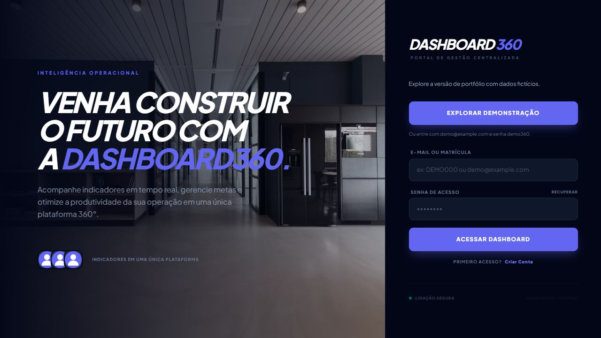

## 2. Painel de controle

Resumo de atendimentos, retenção, cancelamento e UF de destaque, acompanhado de evolução diária e distribuição dos desfechos. O painel distingue sua base fechada D-1 das consultas de acompanhamento ao vivo.

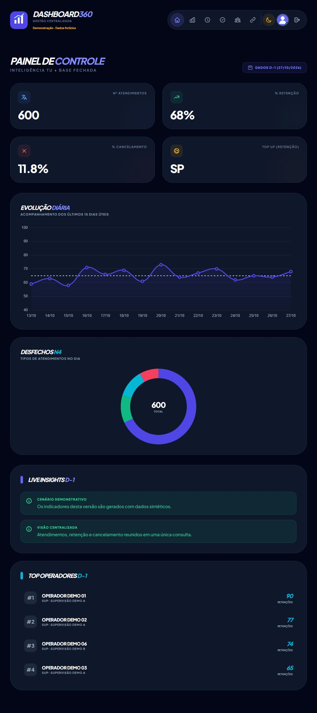

## 3. Inteligência TU

Consulta com filtros por período e liderança, indicadores agregados, ranking de operadores e acesso ao detalhamento dos atendimentos.

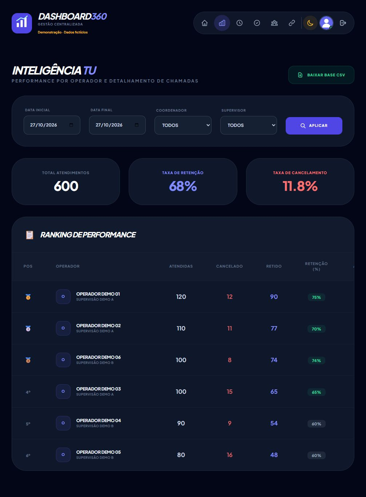

## 4. Metas e performance

Visão mensal com volume de atendimentos, retenção, cancelamento, comparação com metas e diário consolidado.

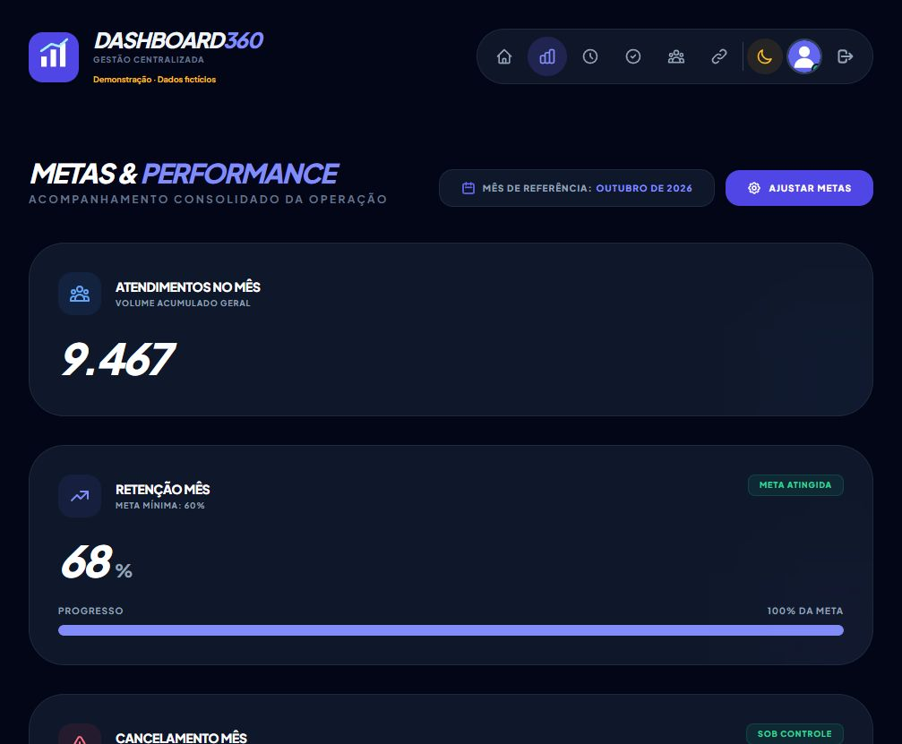

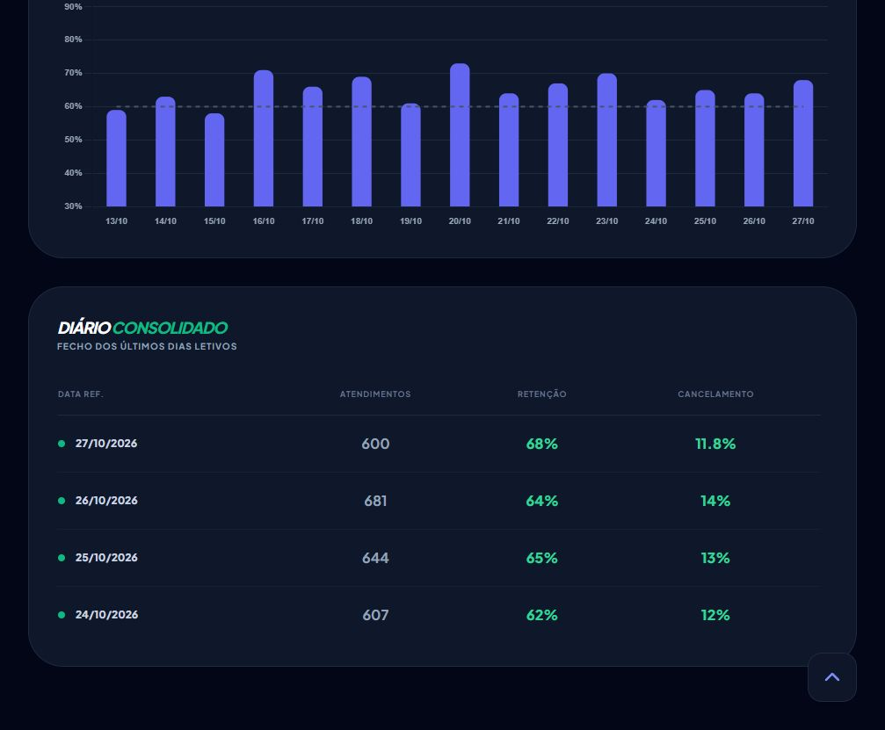

## 5. Monitor WFM — sincronização pausada

Simulação do aviso exibido quando a base deixava de receber os dados do script externo. [Veja o contexto no README](../README.md#monitor-wfm).

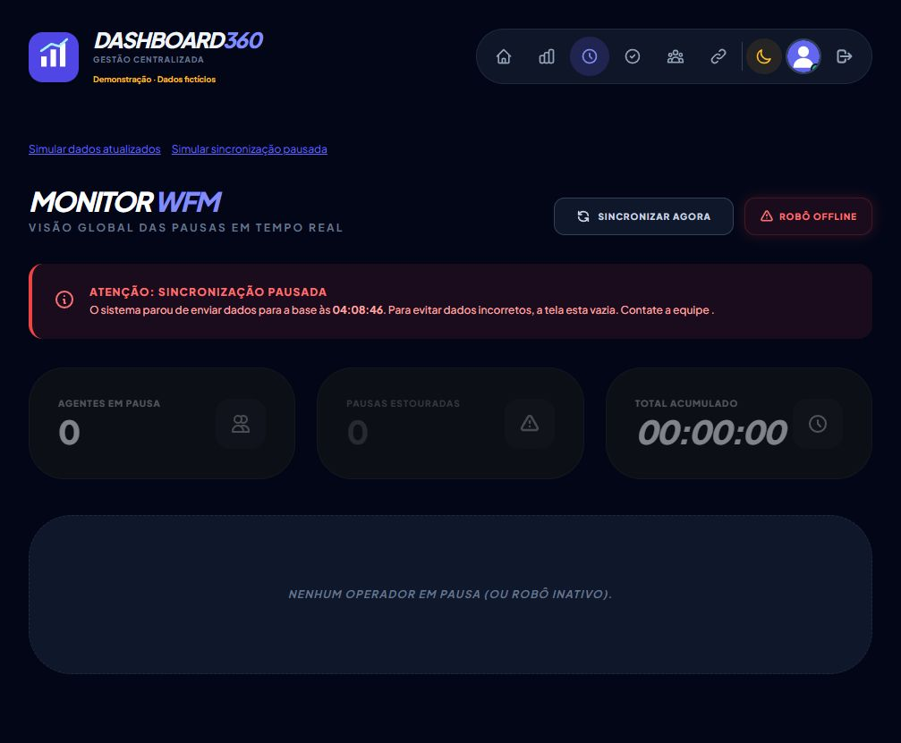

## 6. Gestão de banheiro

Cards com operadores em pausa, tempo decorrido e comparação com o limite configurado, além de contagem e tempo acumulado.

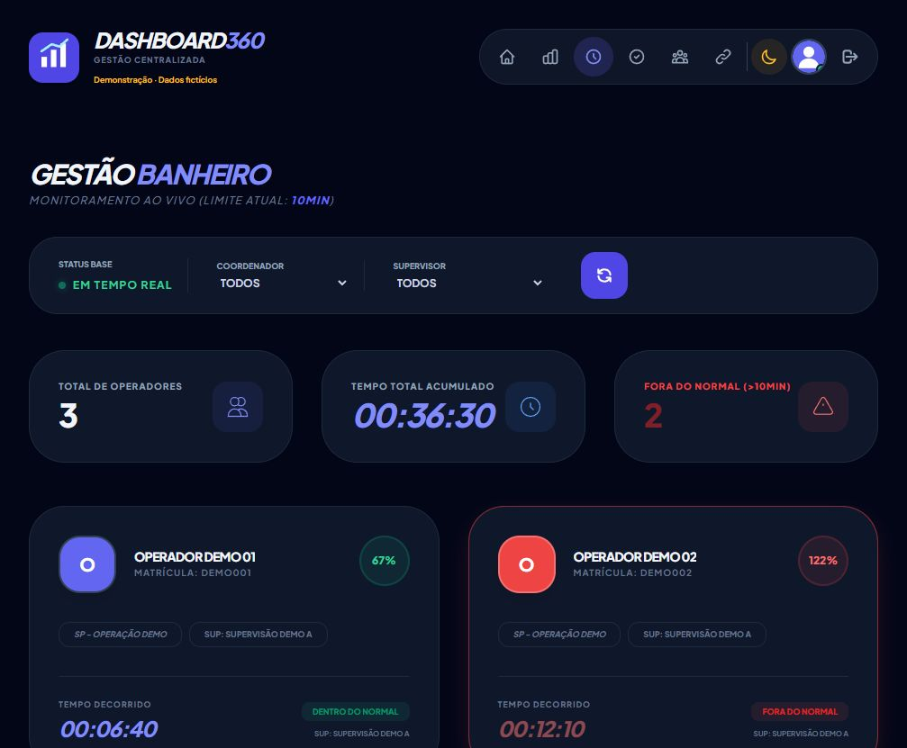

## 7. Tempo logado

Visão consolidada dos percentuais de tempo logado e pago, com filtros de referência e liderança e indicadores por operador.

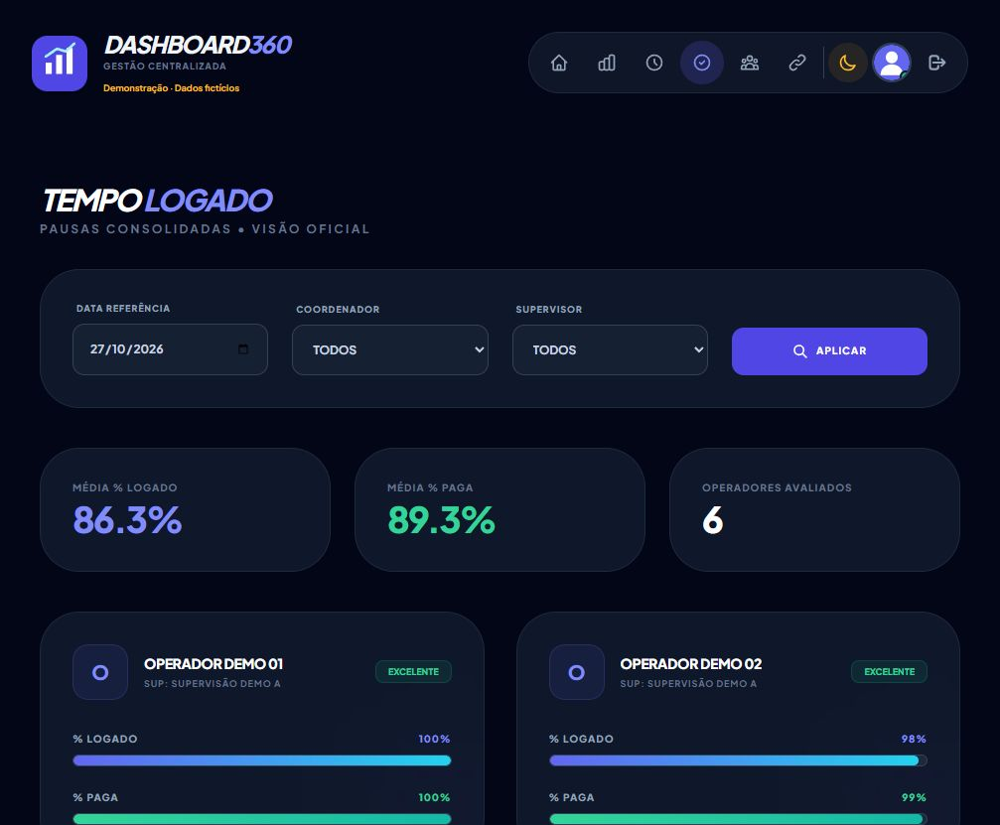

## 8. Gestão de pausas

Consulta de pausas consolidadas por tipo e status, com duração, excesso e ação para registrar justificativa.

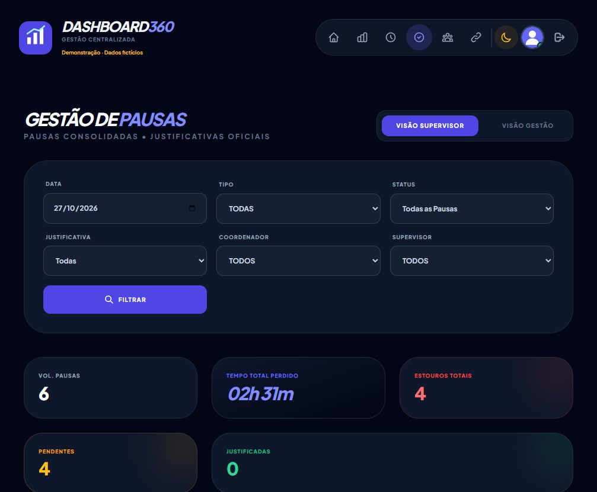

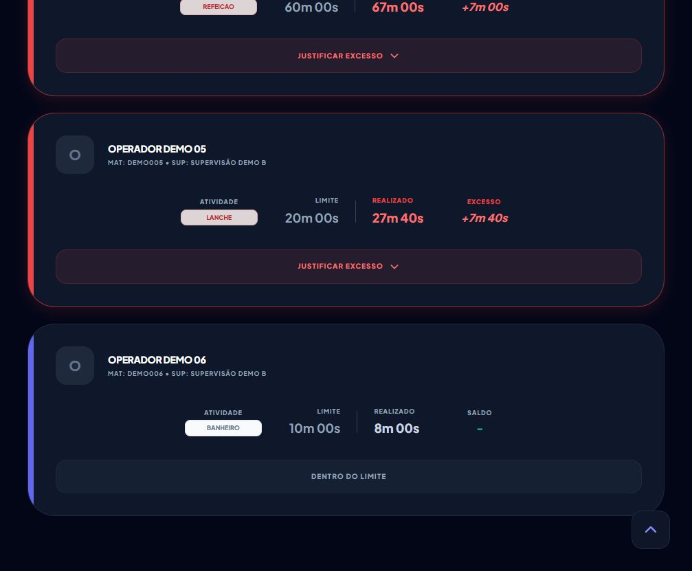

## 9. Perfil

Área de gestão da conta, informações pessoais e alteração de credenciais.

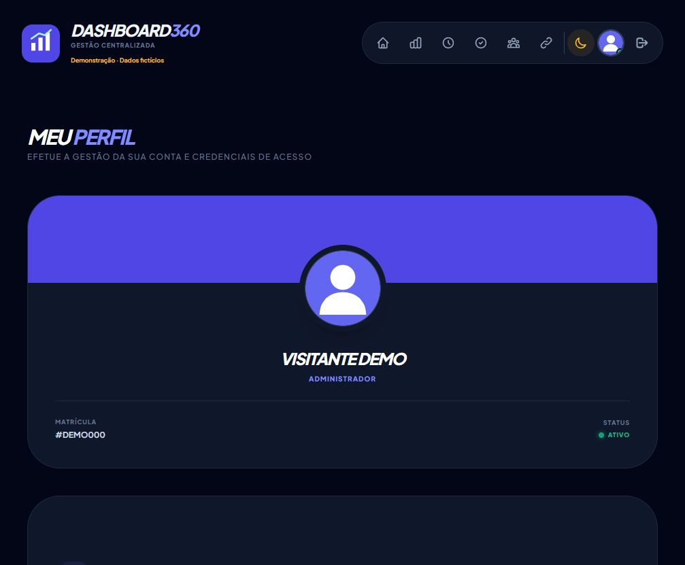
